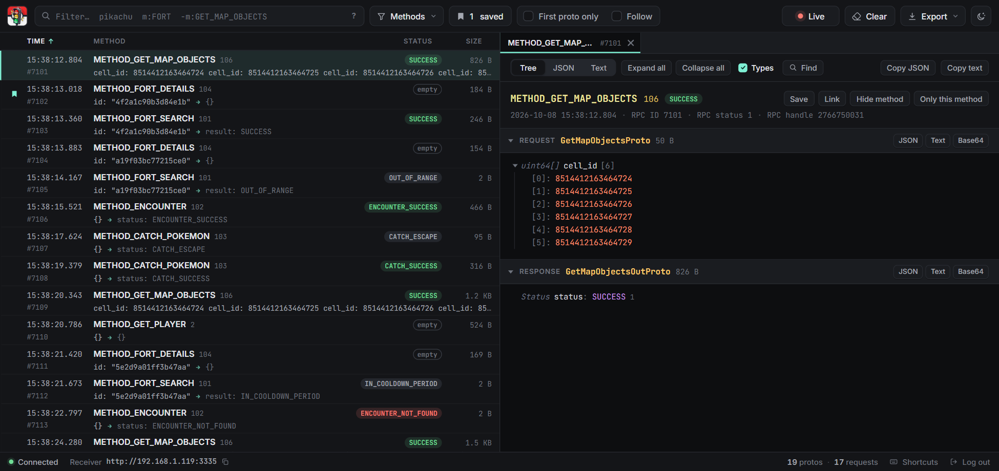
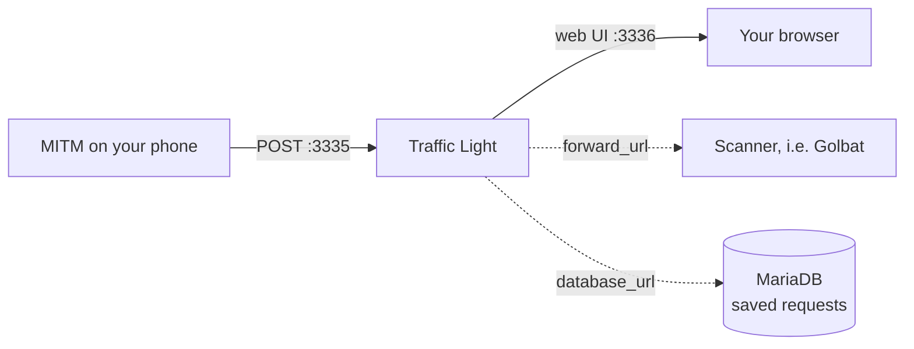

<p align="center">
  
</p>

<h1 align="center">Traffic Light</h1>

<p align="center">
  <strong>Beautiful traffic logging for PGO</strong><br />
  Every request the game makes, decoded in real time, in your browser.
</p>

<p align="center">
  
  
  
</p>

<p align="center">
  <a href="#quick-start">Quick start</a> ·
  <a href="#what-you-get">What you get</a> ·
  <a href="#configuration">Configuration</a> ·
  <a href="#documentation">Documentation</a> ·
  <a href="#project-layout">Project layout</a>
</p>



## What it is

A MITM app on your phone POSTs every request the game makes to Traffic Light. Traffic Light keeps
them, decodes the protobufs and shows them as they arrive, so you can see exactly what is going on
while you play. It can pass everything on to your scanner at the same time.



It is a single binary with the web UI and the protos inside of it. The dotted parts are optional.

> [!NOTE]
> This is a fork of [ccev/TrafficLight](https://github.com/ccev/TrafficLight), rewritten in Go around a
> web UI. It takes the same traffic and the same `config.toml`. The terminal UI and the Discord
> output of the original are not part of it.

## Quick start

With Docker:

```sh
git clone https://github.com/pokemaplx/TrafficLight && cd TrafficLight
docker compose up --build
```

Or with Go 1.24 or newer:

```sh
git clone https://github.com/pokemaplx/TrafficLight && cd TrafficLight
go run ./cmd/trafficlight
```

Open <http://127.0.0.1:3336>, point your MITM's POST destination at `http://{your computer's IP}:3335`,
and traffic starts showing up. No configuration is needed for that. Running it on a server is in
[Deployment](docs/deployment.md).

## What you get

- **A log you can work in.** Filter by method, message, status or content, sort by any column,
  open several protos in tabs, split and diff two of them, search inside one, and export what you
  see. → [The web UI](docs/web-ui.md)
- **Memory that stays put.** The log holds what your MITM sent and nothing else, within a limit
  you set in megabytes. About 200 MB with the default, 30 MB when idle. → [Memory](docs/memory.md)
- **Protos that keep up.** Traffic Light looks for newer protos while it runs and switches to
  them without a restart. → [Protos](docs/protos.md)
- **Your scanner keeps its traffic.** Everything can be forwarded untouched to another endpoint,
  without ever making your MITM wait for it. → [Traffic](docs/traffic.md)
- **Requests worth keeping.** Save one and it is never dropped. With a MariaDB it is still there
  after a restart. → [Saved requests](docs/web-ui.md#keeping-requests)

## Configuration

Traffic Light runs without any. To change something, copy `config.example.toml` to `config.toml`
next to where you run it, or set the option as an environment variable: `web_password` is
`TRAFFICLIGHT_WEB_PASSWORD`. The environment wins over the file.

| option | default | what it does |
| --- | --- | --- |
| `host` `port` | `0.0.0.0` `3335` | where the receiver listens for your MITM |
| `output` | `web` | `web`, or `print` for a plain log on stdout |
| `forward_url` | empty | also pass every request on to this endpoint. → [Traffic](docs/traffic.md#forwarding) |
| `forward_token` | empty | bearer token sent with the forwarded request |
| `web_host` `web_port` | `127.0.0.1` `3336` | where the web UI listens. `0.0.0.0` opens it to your network |
| `web_password` | empty | makes the web UI ask for a password. → [Deployment](docs/deployment.md#password-and-domains) |
| `web_open_browser` | `true` | open a browser when Traffic Light starts |
| `web_max_records` | `5000` | how many requests the log keeps |
| `web_max_memory_mb` | `128` | how much they may weigh. `0` for no limit. → [Memory](docs/memory.md) |
| `protos_url` | the original Traffic Light's | where newer protos are looked for. Empty to not look. → [Protos](docs/protos.md) |
| `protos_update_hours` | `6` | how often. `0` looks at startup only |
| `methods_url` | empty | a file or URL naming the methods the protos don't know yet |
| `database_url` | empty | keep saved requests in this MariaDB or MySQL database |
| `debug_addr` | empty | serve Go's profiler there, i.e. `127.0.0.1:6060` |

## Documentation

| | |
| --- | --- |
| [The web UI](docs/web-ui.md) | filtering, tabs, diff, saving, exporting, keyboard shortcuts |
| [Traffic](docs/traffic.md) | what a MITM has to send, forwarding, and the limits on requests |
| [Deployment](docs/deployment.md) | Docker, Coolify, a password and a domain, a database |
| [Memory](docs/memory.md) | what Traffic Light uses, how to limit it, how to see where it goes |
| [Protos](docs/protos.md) | how they stay current, and naming methods before their protos exist |
| [Development](docs/development.md) | how the code is laid out, tests, benchmarks |

## Project layout

```
cmd/
  trafficlight/    the program
  protoupdate/     refreshes the protos a build starts out with
ui/                the browser side: one page, plain ES modules, no build step
internal/
  traffic/         what a MITM sends, still encoded. Everything else passes these around
  receiver/        takes them over http
  forward/         passes them on to another endpoint
  protos/          which protos are in use, and keeping them current
  decode/          makes sense of traffic with them: text, json, the inspector's tree
  output/
    web/           the log, and the server browsers look at it with
    printer/       a plain log on stdout
  archive/         saved requests that outlive a restart
    mariadb/
  config/          config.toml and the environment
docs/              everything this page links to
```

A request goes through them from top to bottom: the receiver reads it, hands it to the forwarder
and to an output, and the output decodes it when somebody looks. More in
[Development](docs/development.md).
